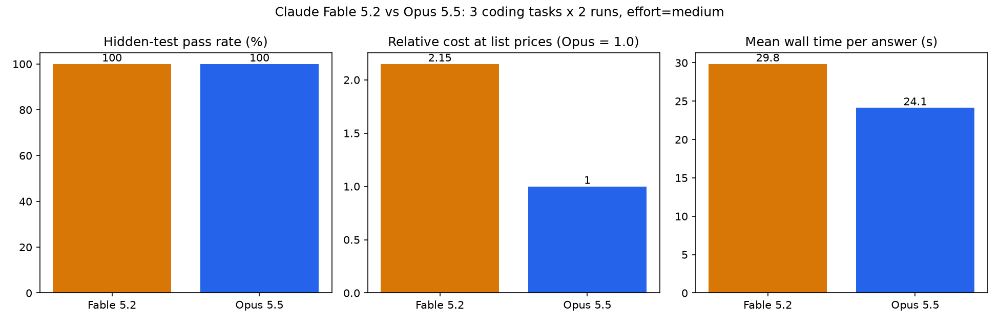

# Claude Fable 5.2 vs Claude Opus 5.5: a small side-by-side coding test

Three Python coding tasks, the same prompt and settings for both models, two runs per model per task, scored by hidden pytest suites the models never saw. Run on 10 November 2026, one day after Claude Fable 5.2 became available on the API.



## Headline

| Model | Hidden tests passed | Fully passing solutions | Relative cost at list prices | Mean wall time per answer | Mean output tokens (incl. thinking) | Mean thinking tokens | Mean non-blank LOC |
|---|---|---|---|---|---|---|---|
| Claude Fable 5.2 (`claude-fable-5-2`) | 162/162 (100%) | 6/6 | 2.15x | 29.8 s | 3,286 | 1,231 | 113 |
| Claude Opus 5.5 (`claude-opus-5-5`) | 162/162 (100%) | 6/6 | 1.00x | 24.1 s | 3,043 | 824 | 131 |

Both models solved every task on every run. At this difficulty and this effort level the difference is cost and latency, not correctness: Fable 5.2 cost 2.15x as much per passing solution (list prices: Fable 8/40, Opus 4/20 per million input/output tokens) and took 24% longer on average.

Full per-run table: [results.md](results.md). Machine-readable: [results.json](results.json).

## What was tested

| Task | Type | Hidden tests | What it checks |
|---|---|---|---|
| `a_free_slots` | Pure function | 29 | Free calendar windows from busy intervals: strict HH:MM parsing, "24:00", unsorted/overlapping/touching intervals, clipping, min length, input not mutated |
| `b_invoice_bugfix` | Bug fix | 25 | A buggy invoicing module with four vague bug reports and a correct docstring. Hidden bugs not in the reports: coupon applied after tax, uncapped fixed coupon, no coupon validation |
| `c_ttl_cache` | Two-file feature | 27 | Thread-safe LRU cache with per-entry TTL, injectable clock, stats, plus a stdin CLI tested via subprocess |

Each task folder has `prompt.md` (sent verbatim), `tests/` (hidden suite) and `reference/` (my own solution, used to validate the tests). The buggy module for task B is in `tasks/b_invoice_bugfix/buggy/`.

## Settings (identical for both models)

- Messages API, one user turn, no system prompt, no tools
- `max_tokens`: 6000
- `thinking`: `{"type": "adaptive"}` (the only thinking mode both models accept)
- `output_config.effort`: `"medium"` (set explicitly; the API defaults differ: Fable 5.2 defaults to high, Opus 5.5 to medium)
- Temperature: default
- 2 runs per model per task, run order alternated per round to avoid time-of-day bias
- A hard budget guard in `run_test.py` refuses any call whose worst-case cost would push cumulative spend over a set cap. The spend ledger is written outside the repo and is not committed.

No answer hit `max_tokens`; all 12 ended with `end_turn`.

## Repo layout

```
run_test.py            # run | score | judge | report | all
run_probes.py          # post-hoc robustness probes (not part of the primary score)
tasks/<task>/          # prompt.md, tests/, reference/ (and buggy/ for task B)
runs/<task>/<model>/runN/
    request.json       # exact request body (no key)
    response.json      # raw API response
    response.md        # text part of the answer
    solution/*.py      # code extracted from the answer
    pytest.log         # hidden-test output
    meta.json          # wall time, stop reason
judge/                 # blind LLM judge prompt, mapping, raw response, result
probes/                # post-hoc probes and their results
results.json, results.md, scores.json, chart.png
```

## Reproduce with your own key

```bash
git clone https://github.com/swiftverse/fable-vs-opus-coding-test
cd fable-vs-opus-coding-test
python3 -m venv .venv && . .venv/bin/activate
pip install -r requirements.txt
export ANTHROPIC_API_KEY=sk-ant-...     # never commit this
rm -rf runs judge scores.json           # start clean, otherwise saved runs are reused
python run_test.py all                  # 12 contestant calls + 1 judge call, then score and report
python run_probes.py                    # optional extra probes
```

Change `MODELS`, `RUNS_PER_MODEL`, `MAX_TOKENS`, `EFFORT` or `BUDGET_USD` at the top of `run_test.py`. Hidden tests run with the API key removed from the environment.

## Blind code-quality judgement (LLM opinion, not a measurement)

One call to `claude-sonnet-5-5` with all 12 solutions shuffled and labelled S1 to S4 per task. Mapping saved in `judge/mapping.json` before the call.

| Model | Spec fidelity | Robustness | Readability | Maintainability | Overall |
|---|---|---|---|---|---|
| Fable 5.2 | 8.67 | 8.67 | 8.5 | 8.5 | 8.5 |
| Opus 5.5 | 8.83 | 8.67 | 8.5 | 8.5 | 8.67 |

Per-task picks: free_slots went to Opus run 2, invoice to Fable run 2, TTL cache to Opus run 1. The gap is within noise, and the judge's notes also mention a NaN ttl problem in the CLI that the probes below show does not exist. Treat this section as colour, not evidence.

## Post-hoc probes

All 12 solutions scored 100%, so I wrote extra probes from the specs afterwards (non-ASCII digits, NaN/Infinity coupons and TTLs, float and Decimal prices, CLI argument errors, throughput). All 12 model solutions passed all of them. My own reference solutions failed 6 of them (Unicode digits accepted by `\d`, bad prices raising `InvalidOperation` instead of `ValueError`). Timings are in `probes/probe_results.json`, and they vary more between runs of the same model than between the two models. See `probes/README.md`.

## Caveats

- Small sample: 3 tasks, 2 runs each, 12 contestant answers. That is enough to show that both models clear tasks of this size and to measure token use and latency. It is not enough to rank them on hard problems.
- Ceiling effect: both models hit 100%, so the hidden tests could not separate them. A harder task set (multi-step agentic work, larger repos) could tell a different story.
- One effort level (medium). Fable 5.2's default is high, which would cost more and might change results on harder tasks.
- Single-turn, no tools, no repository context. This is not a test of agentic coding.
- Run one day after Fable 5.2's launch. Latency depends on load and may change.
- Cost figures are relative indices computed from returned token counts at list prices, not from an invoice.
- The judge is another Claude model, so it may share blind spots with the contestants.

## License

MIT, see [LICENSE](LICENSE).
